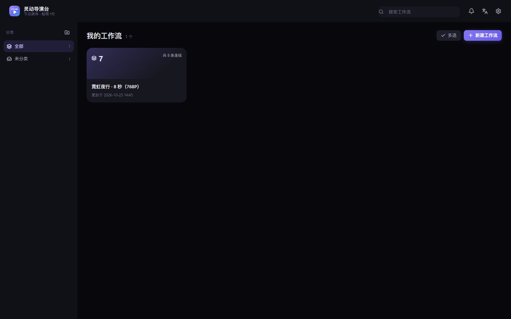
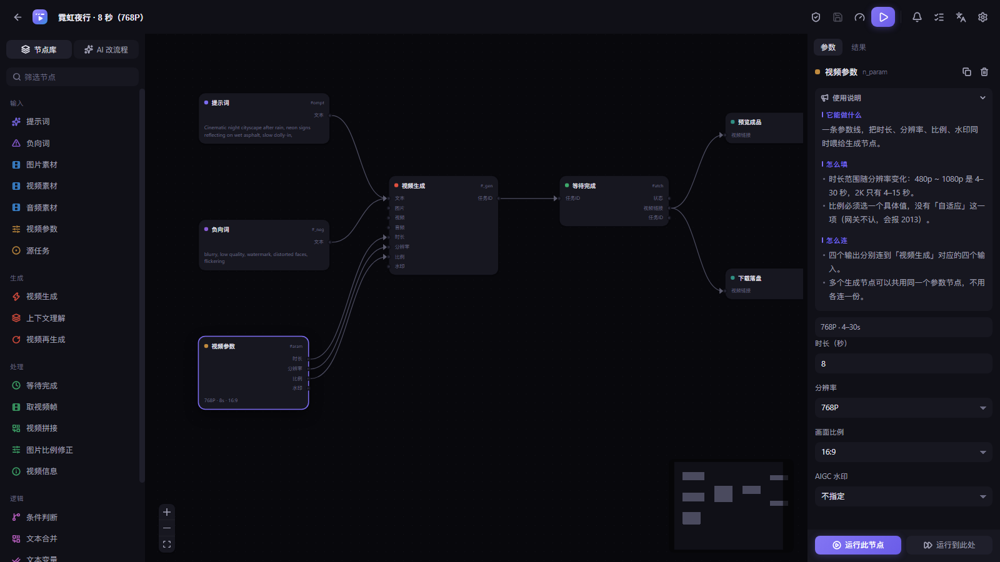

# 灵动导演台 · LingXi Director

> 本地跑的 **AI 视频生成节点画布工作台**：拖节点搭出生成流程 → 提交 → 轮询 → 预览 / 下载。
> 前端 React + React Flow，后端只用 Node 内置模块（含 `node:sqlite`），媒体处理走 npm 分发的 ffmpeg 二进制。

接入的是与 **MiniMax 官方 `/v2` 同构**的网关协议（默认指向秘塔 H3）。换平台只需改 `web/src/graph/model.js` 里的 `PROVIDER` 常量。

> 💡 本项目作者的另一款产品：[**灵犀 AI 助手**](https://lingxi.regaing.com) —— 本地优先、多模型接入的 AI 工作台。

---

## 界面





## 特性

- **节点画布**：20 类节点，拖拽连线即成流程；连线即参数传递
- **SQLite 唯一真相**：图、分类、通知、运行记录全落 `data/workbench.db`，不再依赖 JSON 文件
- **执行引擎**：拓扑排序 + SSE 实时状态 + 失败自动清理（全额退款）+ 单步运行 + 干跑预估（`dryRun`）
- **AI 改流程**：一句话 → LLM 输出**语义化 ops** → 服务端校验 → 应用后再做确定性补齐（不静默覆盖）
- **媒体处理**：抽帧、拼接、比例修正、探针，跨节点串联多条视频
- **中英双语**：跟随浏览器语言，缺省中文

## 环境要求

- **Node >= 22**（依赖内置 `node:sqlite`）
- 无需单独安装 ffmpeg：`npm install` 会带好 `@ffmpeg-installer/ffmpeg` + `@ffprobe-installer/ffprobe`

## 快速开始

```bash
npm install          # 仅首次，顺带装 ffmpeg/ffprobe 二进制
npm run build        # 产出 public/；改过 web/ 后必须重跑
node server.mjs      # 等同 npm start
```

打开 http://127.0.0.1:8070 （`PORT` 可改）。

开发模式（前端热更新）：

```bash
npm run dev          # Vite 5173，/api 与 /downloads 代理到 8070
```

## 配置

`config.json` **不进仓库**（已 gitignore），首次使用自行在项目根目录创建：

```json
{
  "token": "mk-****",
  "baseUrl": "https://metaso.cn/api/minimax",
  "llm": {
    "baseUrl": "https://api.deepseek.com",
    "model": "deepseek-flash",
    "apiKey": "sk-****",
    "maxTokens": 65536,
    "contextWindow": 1048576
  }
}
```

- `token`：网关鉴权，走 `Authorization: Bearer <token>`
- `baseUrl` 优先级：`config.json` > 环境变量 `MINIMAX_BASE_URL` > 内置默认
- `llm` 留空则「AI 改流程」不可用，其余功能不受影响；也可用 `LLM_API_KEY` 覆盖
- `llm` 走 OpenAI 兼容协议，换模型或换自建网关只改这三项

> 密钥只存本机。请勿把 `config.json` 提交进任何仓库。

## 支持的平台

当前内置 **秘塔 H3**。换平台只需改 `web/src/graph/model.js` 里的 `PROVIDER` 常量，协议层与 MiniMax 官方 `/v2` 同构。

| 平台 | 官网 | 最低价格 | 说明 |
|---|---|---|---|
| **秘塔 H3** | [metaso.cn/minimax-h3](https://metaso.cn/minimax-h3) | **¥0.06 / 秒**（480p · ≤15 秒 · 标准通道） | 单次 4 秒起，最长 30 秒 |

### 秘塔 H3 计费

| 分辨率 | ≤15 秒 | 16–30 秒 |
|---|---:|---:|
| 480p | ¥0.06 / 秒 | ¥0.12 / 秒 |
| 768P | ¥0.09 / 秒 | ¥0.18 / 秒 |
| 1080p | ¥0.14 / 秒 | ¥0.28 / 秒 |
| 2K | ¥0.15 / 秒 | 暂不支持 |

- **优先通道**：在上述价格基础上 ×2
- **Context IR**（提示词润色等）：¥0.05 / 次
- **输入素材**：音频免费；图片前 5 张免费，超出部分 ¥0.05 / 张
- 以上为官网标价，实际按账号积分扣费，**以官网实时价格为准**

## 画布模型

- `#/` 首页：按分类列出所有画布，可新建 / 重命名 / 复制 / 移动 / 删除
- `#/wf/<id>` 编辑器

**20 类节点**

| 分组 | 节点 |
|---|---|
| 输入 | `text.prompt` 提示词 · `text.negative` 负向词 · `media.image` 图片素材 · `media.video` 视频素材 · `media.audio` 音频素材 · `param.video` 视频参数 · `task.source` 源任务 |
| 生成 | `gen.video` 视频生成 · `gen.context` 上下文理解 · `gen.regen` 视频再生成 |
| 处理 | `video.frame` 抽帧 · `video.concat` 拼接 · `image.fit` 比例修正 · `video.info` 探针 |
| 逻辑 | `logic.condition` 条件分支 · `text.merge` 文本合并 · `text.vars` 变量替换 |
| 输出 | `task.watch` 等待完成 · `output.preview` 预览 · `output.download` 下载 |

**关键约定**

1. **首尾帧与参考素材互斥**（`PROVIDER.framesVsRef`）
2. **时长按分辨率分化**：480p / 512p / 768P / 1080p = 4–30 秒；2K = 4–15 秒，整数
3. `ratio` 必须显式传枚举值：`16:9` `4:3` `1:1` `3:4` `9:16` `21:9`（不传会被拒）
4. 视频再生成的 `source_task_id` 与 `content` **恰好传一个**，分辨率固定 2K
5. 素材宽高比须在 **0.4–2.5** 闭区间；越界用 `image.fit` 自动加边
6. 素材以 **base64 data URI** 塞进 `content`，请求体上限 200MB
7. 错误码 `2013` 是**通用「参数校验失败」**，需读 message 判断具体参数

## 架构要点

- **图唯一真相** = `data/workbench.db` 的 `workflows` 表；写入走 revision 乐观锁，冲突返回 `409`，不静默覆盖
- **外部改图**一律走 HTTP ops（`/patch`、`/ai`）→ SSE `wf:changed`；不监听文件
- **AI 应用后必补齐**（`lib/graph-complete.mjs`）：`gen.* → task.watch → output.preview + output.download`，`gen.video` 缺负向词则补一个
- **运行态与图分离**：`runNodes` 只在渲染时合成，永不写回图
- **同一画布同时只允许 1 个 run**（第二个返回 409，防重复扣费）

## 目录

```
server.mjs            本地服务：静态托管 + 网关薄代理 + 产物下载 + 图/分类/通知路由
runner.mjs            执行引擎：拓扑排序 + 节点 handler + 失败清理 + 单步运行
lib/
  db.mjs              SQLite 连接（node:sqlite）+ 建表 + WAL
  workflows.mjs       图存储：CRUD + revision 乐观锁 + 语义化 ops patch + 分类
  notifications.mjs   通知存储（保留最近 200 条）
  runs.mjs            运行记录存储（每工作流保留最近 50 条）
  graph-complete.mjs  应用 AI 结果后的确定性补齐（幂等）
  migrate-json.mjs    旧 workflows/*.json → SQLite 一次性导入
  sse.mjs             SSE 广播：心跳 + Last-Event-ID 重放
  llm.mjs             LLM 层：图 ops + 提示词优化（OpenAI 兼容）
  media-tools.mjs     ffmpeg 封装：抽帧 / 探针 / 加边 / 拼接
web/src/              前端源码（React + React Flow）
  pages/              Home（分类 + 多画布）/ Editor（画布）
  graph/model.js      节点唯一扩展点：类型 / 端口 / 字段 / 校验 / LLM schema
  i18n.jsx            中英字典
  presets.js          剧本预设模板
  styles.css          设计令牌（靠色阶分层，不靠边框）
public/               前端构建产物（gitignore）
data/                 SQLite 库（gitignore）
assets/ downloads/ out/  运行时素材与产出（gitignore）
```

## 本地接口

| 接口 | 作用 |
|---|---|
| `GET /api/workflows` | 画布列表 |
| `POST /api/workflows` | 新建画布（可带 `categoryId`） |
| `POST /api/workflows/move` | 移动到分类 |
| `GET /api/workflows/events` | SSE：图变更推送 `wf:changed` |
| `GET /api/workflow/:id` | 读取图（带 revision） |
| `PUT /api/workflow/:id` | 整体替换，支持 `If-Match` 乐观锁（冲突 409） |
| `POST /api/workflow/:id/patch` | 语义化增量操作（`add_node` / `update_node` / `remove_node` / `connect` / `disconnect`） |
| `POST /api/workflow/:id/ai` | 自然语言改流程，LLM 出 ops → 校验 → 应用 |
| `POST /api/workflow/:id/duplicate` | 复制画布 |
| `DELETE /api/workflow/:id` | 删除画布 |
| `GET/POST /api/categories` | 分类列表 / 新建 |
| `POST /api/categories/reorder` | 分类排序 |
| `PATCH/PUT/DELETE /api/category/:id` | 更新 / 删除分类 |
| `GET/POST/DELETE /api/notifications` | 通知列表 / 新增 / 清空 |
| `POST /api/notifications/read` | 标记已读 |
| `POST /api/llm/optimize` | 提示词优化，返回预览不直接写回 |
| `POST /api/assets` | 上传素材（base64 → 落盘，返回引用） |
| `GET /api/assets/:name` | 读取素材 |
| `POST /api/run` | 起一次运行；`dryRun:true` 只回计划与预估金额 |
| `GET /api/runs?wfId=` | 运行历史 |
| `GET /api/run/:id` | 运行状态与各节点状态 |
| `GET /api/run/:id/events` | SSE：`run:start` / `run:node` / `run:done` |
| `POST /api/run/:id/cancel` | 取消并清理已创建的网关任务 |
| `GET/POST /api/settings` | 设置（Token / 网关 / LLM）；key 只回掩码 |
| `GET/POST /api/config` | 旧接口，仅保留兼容 |
| `POST /api/generate` | 转发创建任务 |
| `GET /api/task` · `GET /api/tasks` · `DELETE /api/task` | 任务查询 / 取消 |
| `POST /api/download` | 拉取产物落盘 |

## 已知限制

- 网关只保留最近 7 天、未删除的任务，过期查询返回 404
- `429` / `503` 是限流或渠道满，按后端 message 手动重试
- 参考视频走 base64 会让请求体很大（上限 200MB），长视频建议改公网 URL
- 下载产物是带签名的 CDN 链接，过期需重新查询任务换取新链
- 输出视频是否带音轨未验证，需要声音请后期配

## 许可证

[MIT](LICENSE)

## 关于作者

本项目由 [灵犀 AI 助手](https://lingxi.regaing.com) 的作者开发。灵犀是一个本地优先、多模型接入的 AI 工作台，覆盖聊天、代码、文件操作、电脑控制与团队协作，支持 Windows / macOS / Linux。

👉 **https://lingxi.regaing.com**
